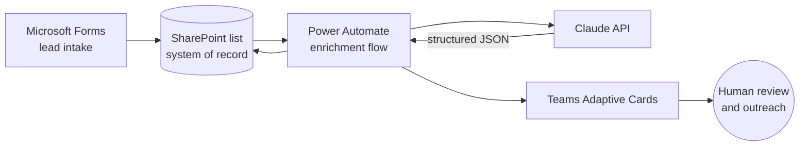

# AI-Assisted Lead Qualification & Routing

An AI-assisted intake system for **3509 Innovations**: Microsoft Forms, SharePoint, Power Automate, the Claude API, and Teams cards that score and route every new lead.

> A lead fills out a form. By the time I open Teams, it has already been scored, matched to an offer, and given a next step.

📄 **Full case study with screenshots:** [iamnicolecoleman.com/portfolio/ai-lead-qualification-routing](https://iamnicolecoleman.com/portfolio/ai-lead-qualification-routing/)

---

## The problem

Every new inquiry cost an hour or more before I could respond: read the form, research the business, decide whether it was a fit, pick the right offer, and set a follow-up reminder. Leads waited, and the reasoning lived in my head or in scattered email threads.

I needed every lead captured the same way, a first-pass assessment waiting for me, and a follow-up date that could not slip.

## Architecture

| Step | Component | What happens |
|---|---|---|
| 1. Intake | Microsoft Forms | Company, team size, current tools, budget range, timeline, and the bottleneck to fix |
| 2. System of record | SharePoint list | One row per lead: every input and every AI output |
| 3. Enrichment | Power Automate → Claude API | Clean the input, call the API, parse the result, update the record |
| 4. Structured result | JSON response | Fit score · recommended offer · next step · follow-up date · notes |
| 5. Notify | Teams Adaptive Cards | Card 1: a lead arrived. Card 2: the enriched assessment |
| 6. Decide | Me | I review and reach out. The AI never contacts or rejects a lead |

## Design choices that mattered

- **SharePoint as the system of record.** Contact preference, budget, source, and every AI output live in one row I can sort, filter, and report on.
- **Clean free text before calling the API.** The "bottleneck" answer is whatever a person types, including quotes and line breaks. A compose step makes it safe to drop into the JSON request so a messy answer can't break the call.
- **Structured output, not a paragraph.** Claude returns JSON with fixed fields. The flow parses the API response, then parses that JSON, so each value maps straight to its own SharePoint column.
- **Two cards for two moments.** The first says a lead exists. The second gives me what I need to decide.
- **A human makes the call.** The AI output is advisory only.

## Outcome

Live and handling every 3509 inquiry. Work that took an hour or more per lead now arrives already scored and summarized, every lead gets a documented next step and follow-up date, and nothing sits unread in an inbox.

## My role

Designed and built end to end: intake form, SharePoint list design, Power Automate flows, Claude prompt and response format, and Teams Adaptive Cards. Built in my own 3509 Innovations Microsoft 365 environment.

---

This repository documents the system design. Screenshots (test lead, contact details blurred) are in the case study linked above.
